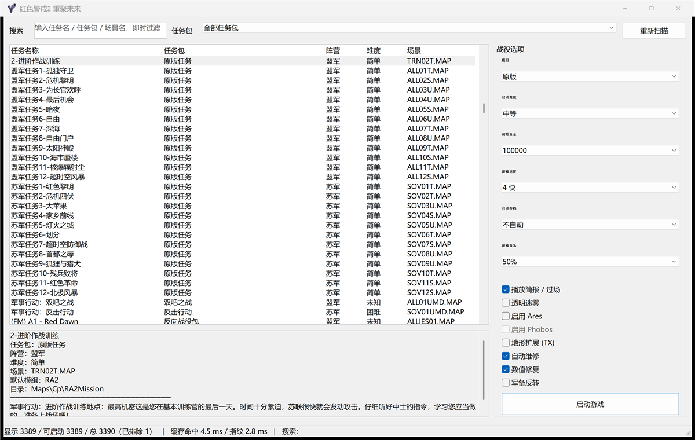

# Reunion Lite

轻量、离线、零第三方依赖的《红色警戒2 重聚未来》战役启动器。

> 版本 0.1 · Windows x64 · GPLv3



> **这是一个 Reunion 的极简版本，只保留了核心的任务包 / Mod 加载功能，适用于单机玩家。现在只支持 Windows 和原版游戏文件；计划后续通过 vera20k 引擎增加 Linux / macOS 支持。**

## 这是什么

原版 `Reunion.exe` 是一个基于 MonoGame / XNA 的完整客户端，带大厅、更新器、预览图渲染、皮肤、音乐播放器等大量功能。它的代价是启动慢、常驻 CPU/GPU 开销高，而且每次启动都会重新扫描全部战役。

Reunion Lite 只保留核心链路：

**扫描战役 → 按选项加载 Mod / 地图 → 启动游戏 → 接续下一关**

没有联网对战、在线更新、反作弊、Discord、预览图渲染或自绘界面。

## 特性

- **快速浏览海量战役**：本机 3,390 条记录，1,246 个战役注册文件。
- **懒扫描缓存**：启动只做一次目录指纹（~3 ms）+ 二进制缓存读取（~4 ms）；只有点击“重新扫描”或检测到 `Battle*.ini` 变化时才全量扫描（~160 ms）。
- **即时检索**：任务名 / 任务包 / 场景名 / 难度 / 阵营，输入即过滤。
- **纯系统标准控件**：Edit / ComboBox / ListView / Button / StatusBar，无自绘窗口、无渲染循环。
- **超低开销**：常驻约 20 MB，空闲 CPU 基本为 0。
- **还原原客户端战役选项**：模组、难度、初始资金、游戏速度、自动存档、透明迷雾、Ares、Phobos、地形扩展、自动维修、数值修复、军备反转。
- **战役接续**：启动时准备同一任务包的全部地图；存档按任务包隔离并在启动时恢复，支持任务间传递状态。
- **音乐与过场**：可选游戏音乐音量；默认播放任务简报与地图脚本触发的过场视频。
- **错误处理**：启动前校验 Mod / 地图 / 场景，失败时报告原因并把该条目从列表排除；游戏内的任务失败不会屏蔽地图。
- **HiDPI**：Per-Monitor V2，自动适配高 DPI 与窗口缩放。
- **无第三方运行库**：静态链接，单个 exe，兼容 Windows 10/11 x64。

## 下载

从 [Releases](https://github.com/yeungtuzi/reunion-lite/releases) 下载：

- `ReunionLite-0.1-win64.exe` — Windows x64
- `SHA256SUMS.txt` — 校验值

把 exe 放到游戏根目录（与 `Reunion.exe`、`Maps`、`Mod&AI`、`Run` 同级），双击运行即可，无需安装。

> 启动器会以 exe 所在目录、当前目录及其上级目录自动查找游戏根目录；从快捷方式或子目录启动也能定位。

## 使用

- 搜索框：输入任务名 / 任务包 / 场景名，即时过滤。
- 任务包下拉：按原客户端的任务包分类筛选。
- 列表：任务名称 / 任务包 / 阵营 / 难度 / 场景。
- 双击任务或按回车：启动。
- “重新扫描”：重建缓存并报告扫描问题。

右侧选项与原客户端 `CampaignSelector` 对齐：

| 选项 | 作用 |
|---|---|
| 模组 | 任务允许的 Mod 列表 |
| 启动难度 | `DifficultyModeHuman` / `DifficultyModeComputer` |
| 初始资金 | 写入地图 `[Basic] Player` 的 `Credits` |
| 游戏速度 | `spawn.ini` 的 `GameSpeed` |
| 自动存档 | 合并对应地图代码 |
| 游戏音乐 | 写入 `[Audio] ScoreVolume` / `InGameMusic` |
| 播放简报 / 过场 | `[Options] SkipAnimation=False`，显示任务简报并播放视频 |
| 透明迷雾 | `chkSatellite` + `shroud.shp` |
| Ares / Phobos / 地形扩展 | 任务要求时强制启用 |
| 自动维修 / 数值修复 | 合并 `Auto Repair.ini` / `Repair.INI` |
| 军备反转 | 原客户端的两向单位替换表 |

## 文件与缓存

- `Client\campaign.cache`：紧凑二进制缓存（注册文件指纹 + 任务包 + 任务 + 排除原因）。
- `ReunionLite.ini`：窗口尺寸（DIP）、筛选、上次选择、选项。
- `Client\ReunionLite.log`：每次启动覆盖写入的简短诊断日志。
- `Run\.rl_base` / `Run\.rl_overlay`：基础文件标记 / 本次写入 Run 的文件清单（下次启动自动清理）。
- `Run\.rl_base_keep`：原版 `thememd.*` 音乐文件的硬链接保护。

删除 `Client\campaign.cache` 或点“重新扫描”即可强制重建。

## 启动流程

1. 解析任务包、任务、`DefaultMod`，从 `Mod&AI\Mod&AI*.ini` 解析模组路径（支持旧安装留下的绝对路径，如 `D:\ra2master\...`）。
2. 准备 `Run`：
   - 基础文件（YR、zh、语音、ddraw、gamemd-spawn.exe）只做一次硬链接/复制；
   - 清理上一次的 Mod / 任务覆盖文件；
   - 链接当前 Mod、任务目录、`.mix` 与 CSF；
   - 准备当前任务包**全部**松散 `.MAP`（MIX 内的地图由游戏读取）；
   - 挂载 Ares / Phobos / TX / 透明迷雾。
3. 写 `spawn.ini`（ANSI/GBK），启动：
   - 普通任务：`Run\gamemd-spawn.exe -SPAWN <ClientDefinitions 参数>`
   - Ares：`Run\Syringe.exe "gamemd.exe" -SPAWN <参数>`
4. 最小化，后台 `WaitForSingleObject` 等待（0 CPU）；游戏窗口关闭或进程退出后恢复窗口，并把 `Run\RA2MD.ini` 同步回根目录。
5. 只有“游戏窗口从未出现”的启动失败才报告并排除地图。

## 性能

| 项目 | 本机实测 |
|---|---|
| 启动指纹 | ~3 ms |
| 缓存读取 | ~4 ms |
| 冷扫描（3,390 条） | ~160 ms |
| 常驻内存 | ~20 MB |
| 空闲 CPU | ~0% |

## 构建

需要 MinGW-w64（g++ / windres / strip），无第三方库。

```powershell
.\build.ps1
# 产物: build\ReunionLite.exe
```

也可以把 MinGW 放到 `tools\mingw\mingw64\bin`，脚本会自动查找。

### 可移植性

- `src/core` 只依赖 C++17 标准库（`std::filesystem`、容器、文件流），无 Win32 调用。
- 系统 ANSI 编解码、目录快速枚举、进程启动、硬链接封装在 `src/platform/win`。
- 非 Windows 平台实现 `encoding.h` 与 `ListIniFileStamps()` 后，接一个原生 UI 即可复用扫描、缓存、启动计划生成与地图选项合并；后续可接 vera20k 等重实现引擎。

## 已知限制

- 没有实现原客户端的 CSF 繁体→简体转换、皮肤合并、主题/音乐打包、评分/成就。
- 地图在 MIX 内时，资金/数值修复/自动存档/军备反转等“改写地图 INI”的选项无法写入（原客户端同样不处理）。
- 存档统一在 `Run\Saved Games` 下按任务包分目录，不写客户端自己的 `Save.ini` 评分元数据。
- 当前 release 为 Windows x64；源码可直接用 i686 MinGW 重新编译 32 位版本。


## 相关项目

- [Reunion / RF-Client](https://github.com/Snowy-Studio/RF-Client) — 原「重聚未来」客户端（GPLv3），本项目的行为与配置格式参考。官网：[www.yra2.com](https://www.yra2.com)
- [vera20k](https://github.com/YuriPlanet/vera20k) — 用 Rust 重写的《红色警戒2：尤里的复仇》引擎；后续 Linux / macOS 支持将基于它。文档：[yuriplanet.github.io/vera20k](https://yuriplanet.github.io/vera20k/zh-CN/)

## 致谢

- [Snowy-Studio / RF-Client](https://github.com/Snowy-Studio/RF-Client)：原「重聚未来」客户端（GPLv3）。本项目的战役格式、`spawn.ini` 字段、选项语义与启动流程均以其为行为参考。
- 重聚未来 / Snowy Studio 制作组与所有任务包作者。
- 程序图标取自原客户端 `Resources\clienticon.ico`。
- 《命令与征服：红色警戒2 / 尤里的复仇》版权归 EA 所有；本仓库不包含任何游戏资源，使用前需自备正版游戏目录。

## License

GPLv3，详见 [LICENSE](LICENSE)。

