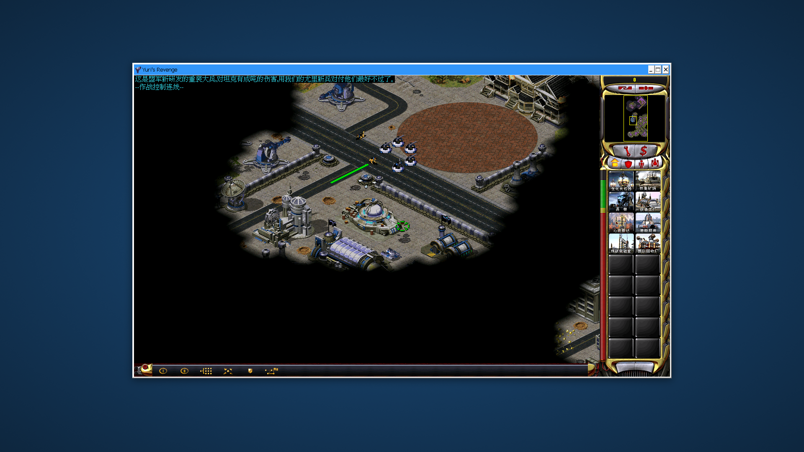

# 在 ARM64 Linux（摩尔线程 M1000）上玩红警2 / 重聚未来

本文记录 Reunion Lite 0.2 在 **aarch64 + 摩尔线程 M1000 + KDE Plasma 6 Wayland** 上的
实际可用配置。其它 ARM64 设备（RK3588、Snapdragon X 等）思路相同，只是 Vulkan/OpenGL
驱动与分辨率不同。

> 结论：能进任务，地图、建筑、单位、侧边栏正常渲染；启动器（Qt6）负责扫描/准备 `Run/`
> 并拉起游戏。



---

## 1. 为什么不能直接用 Proton 跑

`gamemd.exe` 是 **32 位 x86** Windows 程序。两条看似可行的路都不通：

| 方案 | 结果 |
|---|---|
| Proton 11 (ARM64) 的 Wine | 该 Wine 没有 32 位 x86 支持（会去找 `sysarm32\rundll32.exe`），gamemd 起不来 |
| 原生 arm64 Wine + `wow64` | 同上，32 位 x86 不是 arm64 Wine 的 guest 架构 |

可行的是：**x86_64 Wine（Proton Experimental）在 FEX 下运行 32 位 gamemd**。
但这样跑时，Wine 的 32 位 `winex11` 需要 32 位 X11 库，宿主机上没有；
**Steam Linux Runtime 4（sniper）里才有完整的 i386 运行库**。所以启动脚本会：

```
FEX-Emu/fex-compat-tool
  └─ SteamLinuxRuntime_4/_v2-entry-point
       └─ Proton Experimental/files/bin/wine  gamemd-spawn.exe -SPAWN
```

另外，KWin 的 rootless XWayland 在部分驱动上不映射 Wine 顶层窗口，
所以脚本会另起一个专用 **Xorg :3**（`-ac`，1920x1080），把画面切过去，
游戏退出后再切回桌面。

---

## 2. 前置条件

1. **游戏目录**：正版《红色警戒2：尤里的复仇》+ 重聚未来资源（含 `Maps/`、`Mod&AI/`、
   `Resources/`、`gamemd.exe`、`gamemd-spawn.exe`），例如 `~/文档/ra2reunion`。
2. **Steam（arm64）**：已登录，并已安装：
   - `Proton - Experimental`（提供 x86_64 Wine）
   - `SteamLinuxRuntime_4`（提供 32 位 X11/glibc 等运行库）
   - `FEX-Emu`（Steam 的 x86_64 兼容层，装 Proton 时会带上）
3. **cnc-ddraw**：把 `ddraw.dll` + `ddraw.ini` 放到游戏根目录（`Run/` 会硬链接过去）。
   `ddraw.ini` 建议：
   ```ini
   [ddraw]
   windowed=true
   fullscreen=false
   width=1280
   height=720
   renderer=gdi
   maxfps=60
   ```
   M1000 的 OpenGL/D3D 路径不可靠，GDI 渲染最稳。
4. **Qt6 运行库**（自己编译时还需要开发包）：
   ```sh
   sudo apt install qt6-base-dev cmake g++    # 编译
   sudo apt install libqt6widgets6            # 仅运行
   ```

---

## 3. 编译启动器

```sh
git clone https://github.com/yeungtuzi/reunion-lite
cd reunion-lite
cmake -B build -DCMAKE_BUILD_TYPE=Release
cmake --build build -j
# 产物：build/reunion-lite-qt
```

把 `scripts/linux/ra2-launch.sh` 放到工作目录（默认
`$HOME/.local/share/m1000/work/ra2-launch.sh`，可用 `M1000_WORK_DIR` 改）：

```sh
install -Dm755 scripts/linux/ra2-launch.sh \
    "$HOME/.local/share/m1000/work/ra2-launch.sh"
```

---

## 4. 启动

```sh
./build/reunion-lite-qt "$HOME/文档/ra2reunion"
```

选任务 → “启动游戏”。启动器会 `PrepareRun`，然后调用 `ra2-launch.sh`：

- 重启专用 `Xorg :3`（避免长期运行后 X 假死）；
- 用 `DISPLAY=:3` 进入 Steam Runtime（容器只映射 DISPLAY 对应的 X socket）；
- `chvt 8` 切到游戏画面；
- 游戏退出后自动 `chvt 2` 回 KDE。

### 环境变量

| 变量 | 默认值 | 说明 |
|---|---|---|
| `REUNION_LAUNCHER` | `$HOME/.local/share/m1000/work/ra2-launch.sh` | 启动脚本路径 |
| `REUNION_DISPLAY` | `:3` | 改成 `:0` 则直接在当前桌面开窗（部分驱动下窗口不可见） |
| `REUNION_COMPATDATA` | 自动找 `compatdata/*/pfx` | 使用的 Proton 前缀 |
| `REUNION_WINEPREFIX` | 空 | 直接指定 Wine prefix，优先于 compatdata |
| `REUNION_PROTON` | `Proton - Experimental` | Proton 目录 |
| `REUNION_XORG_CONF` | `/opt/steamos/xorg-m1000.conf` 或自动生成 | 专用 Xorg 配置 |

> 前缀里建议把 `winebus` / `wineusb` / `winebth` 三个服务的 `Start` 改成 `4`（禁用），
> 否则 FEX 下 `services.exe` 可能反复崩溃导致 `wineboot` 重跑：
> ```sh
> # 在 prefix 的 system.reg 里，把对应 [System\ControlSet001\Services\winebus] 等
> # 段的 "Start"=dword:00000003 改为 00000004
> ```

---

## 5. 常见问题

### 有进程、没窗口，日志 `no driver could be loaded`

专用 `:3` 在 VT 切换后会“假死”：`xdpyinfo` 还能连，但 `winex11` 加载失败。
0.2 的脚本每次启动都会重启 `:3`；如果手动执行，先重启 Xorg 再启动。

### 崩溃在 `0x7C8D40`，`EXCEPTION_ACCESS_VIOLATION`

旧版地图补丁在 `[Tags]` 行遇到非法 GB18030 字节（如 `90 03`）会截断整行，
游戏读到 NULL 的 tag 字符串。0.2 已修复（非法字节替换为 `?` 后继续）。
删除 `Run/` 后重新“启动游戏”即可重新生成地图。

### `steam -applaunch <appid>` 没反应 / 启动到别的 App

Steam 的命令行会把非 Steam 快捷方式 appid 截断成 24 位（例如
`3676375577 → 2165273`）。不要用 CLI 拉起，直接用本启动器。

### 在 Steam 里添加非 Steam 快捷方式，弹 “Wine C++ Runtime Library”

那是 Proton 内置 `steam.exe`（lsteamclient）在 FEX 下的断言
（`steamclient_main.c:375 Expression: "!status"`），与游戏无关。
本启动器绕开了 Steam 的启动链，不需要这个快捷方式。

### 截图是黑的 / 白色

KWin 的 `spectacle` 抓不到 Wine 窗口内容。用专用 Xorg 抓：
```sh
DISPLAY=:3 import -window root shot.png
```

---

## 6. 已知限制

- 目前只在 **M1000 + KDE Wayland** 上实测；其它 ARM64 GPU 需要确认 Vulkan/DRM 可用性
  （本方案只用 GDI 渲染，理论上要求很低）。
- 启动器不会自动安装/初始化 Proton 前缀；需要先用 Steam 跑一次任意 Proton 游戏，
  或手动准备一个 `compatdata/<appid>/pfx`。
- Ares/Syringe 任务走 `Syringe.exe`（脚本用 `REUNION_EXE` 切换），未在 ARM64 上充分验证。
- 存档、模组、透明迷雾等行为与 Windows 版一致，由 `PrepareRun` 负责。
