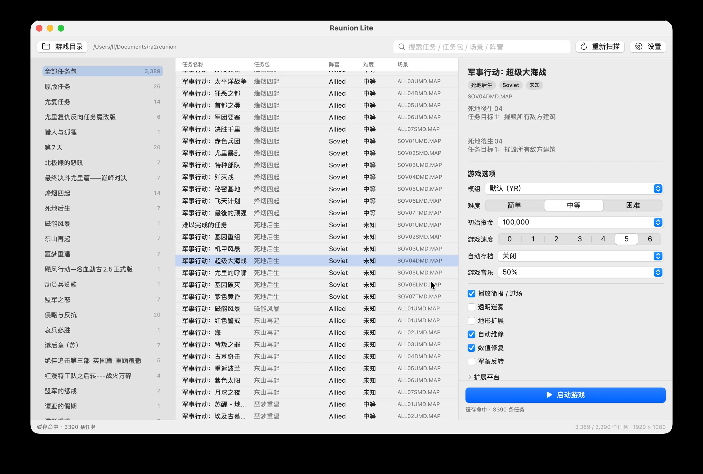

# Reunion Lite for macOS

原生 SwiftUI 启动器 + CrossOver 26 的 Wine，复用
[yeungtuzi/reunion-lite](https://github.com/yeungtuzi/reunion-lite) v0.2 的扫描/`Run`
准备逻辑，用原版 `gamemd.exe` 引擎跑 RA2 / 尤里的复仇 / 任务包。

完整计划见 [MACOS-PLAN.md](MACOS-PLAN.md)。

## 当前状态

| 阶段 | 状态 |
|---|---|
| P1 core 移植（iconv、盘符映射、扫描） | ✅ 3,390 任务 / 3,389 可启动 |
| P2 `Run` 准备（硬链接、覆盖层、地图补丁、存档隔离） | ✅ `rlctl prepare` 可用 |
| P3 Wine 启动集成（命令行/日志/等待/回写） | ✅ 代码就绪，等 CrossOver 实测 |
| P4 SwiftUI 启动器 | ⏳ 未开始 |
| P5 打包 | ⏳ 未开始 |

## 渲染方案（已验证可用）

关键点是**强制使用游戏目录里的 cnc-ddraw，而不是 Wine 内置的 ddraw**：

```bash
wine --bottle RA2 --dll ddraw=n ... --cx-app 'Z:\...\Run\gamemd-spawn.exe' -SPAWN ...
```

- Wine 内置 ddraw 会真的去改显示模式（双屏布局会乱），而且是纯软件渲染，很慢；
- 原生 cnc-ddraw 用 `windowed=true` 出窗口，游戏本身仍保持 `Video.Windowed=False`
  （YR 的 16 位色检查只有在"全屏"路径下才通过）；
- 窗口尺寸 = 游戏分辨率，**1:1、不缩放**（`width/height` 显式写成 1024×768），
  这样鼠标坐标和界面布局不会错位；
- `renderer=gdi`：这是 2D DirectDraw 游戏，GDI 在 Wine 下最稳；`opengl` 在本机会
  出现窗口不显示的问题，所以不作为默认；
- 偶尔的绘制小瑕疵不影响操作。

## 选项与游戏速度

默认值直接读 Windows 客户端留下的配置，行为与 Reunion/ReunionLite 一致：

- `ReunionLite.ini [Options]`：难度、初始资金、游戏速度、自动存档、音乐、
  播放简报、透明迷雾、Ares/Phobos/地形扩展、自动维修、数值修复、军备反转；
- `Client/CampaignSetting.ini [GameOptions]`：客户端上一次的同类选项；
- 模组默认跟随任务的 `DefaultMod`（例如原版任务用 `RA2`）。

查看当前默认值：

```bash
./build/macos/rlctl defaults ~/Documents/ra2reunion
```

覆盖默认值：

```bash
./build/macos/rlctl launch ~/Documents/ra2reunion TRN01T \
  --speed=3 --window=1280x720 --mod=RA2 --difficulty=1 --credits=100000
```

**游戏内调速**：启动参数里始终带 `-speedcontrol`，进游戏后按 `Esc` → 选项菜单，
可以看到 Game Speed 滑块，随时调整。启动时的初始速度由 `--speed=0..6`（写入
`spawn.ini` 的 `GameSpeed`）决定。

## macOS 启动器（SwiftUI）

```bash
./scripts/macos/build-app.sh          # 生成 build/ReunionLite.app（自动签名）
open build/ReunionLite.app

./scripts/macos/install-app.sh        # 构建 + 签名 + 安装到 /Applications
```

不需要 Xcode，只需要 Command Line Tools + Swift 6。

- 签名：自动使用钥匙串里的 Developer ID / Apple Development 证书
  （可用 `REUNION_SIGN_IDENTITY` 指定），没有证书时退回 ad-hoc；
  Apple Development 证书可用于本机，公开分发需要 Developer ID + 公证。
- 窗口位置/大小会记住（`NSWindow` frame autosave）。
- 游戏速度默认 5，可在右侧 0–6 调整，并在游戏内 Esc 菜单实时改。

功能：

- 任务表（单行选择）+ 左侧任务包列表（带数量）+ 即时搜索（名称/任务包/场景/阵营）
- 右侧完整的游戏选项：模组、难度、初始资金、游戏速度（0–6，默认 5）、
  自动存档、音乐、播放简报/过场、透明迷雾、地形扩展、自动修理、数值修复、
  军备反转、Ares/Phobos
- 默认值来自 ReunionLite.ini / CampaignSetting.ini，和 Windows 客户端一致
- 启动 / 结束游戏、运行状态、日志直达、设置（游戏目录、CrossOver、Bottle、
  窗口分辨率、渲染器）
- 默认 1920×1080 窗口，允许拉伸；`-speedcontrol` 常开，游戏内 Esc 菜单可调速



性能与省电：

- 任务列表只在首次启动、点“重新扫描”或更换游戏目录时扫描；结果缓存到
  `~/Library/Application Support/ReunionLite/scan-cache.json`（约 2.9 MB），
  之后启动直接读取，不再访问游戏目录、也不调用 C++ 扫描器；
- 使用 SwiftUI 的 `@Observable`（属性级观察）：改选项、更新状态/日志不会重绘任务表；
- 过滤结果缓存 + 120 ms 防抖 + 预建搜索索引；任务包侧栏虚拟化；单行选择；
- 空闲 CPU 0.0%；启动游戏后自动隐藏启动器（设置里可关），退出游戏后自动恢复。


## 修改器（红色警戒2修改大师）

- 启动器工具栏「修改器」按钮，或菜单 `游戏 → 启动修改器`（⌘⇧T）；
- 设置里可指定修改器路径，并打开「启动游戏时同时启动修改器」（默认开）；
- 修改器和游戏必须运行在同一个 CrossOver bottle（RA2）里，启动器已经这样做；
- 也可直接双击 `/Applications/红色警戒2修改大师.app`（由 `scripts/macos/install-trainer.sh` 安装）。

已验证：修改器能在 Wine 下正常启动、识别「红色警戒2:尤里的复仇 1.001版正在运行」并读写 `gamemd` 内存。

**热键限制**：Wine 下修改器的全局热键（Alt+D / Alt+P / Ctrl+F5…）只在修改器窗口获得焦点时生效；
游戏窗口获得焦点时，RA2 的键盘输入抓取会让全局热键收不到。这是 Wine/输入抓取的限制，不是启动器的问题。
实际用法：点一下修改器窗口再按键（改完点回游戏），或直接点修改器上的按钮。

## 构建 CLI

```bash
./scripts/macos/build-cli.sh
./build/macos/rlctl drives
./build/macos/rlctl scan ~/Documents/ra2reunion
./build/macos/rlctl plan ~/Documents/ra2reunion TRN01T
./build/macos/rlctl prepare ~/Documents/ra2reunion TRN01T
./build/macos/rlctl launch ~/Documents/ra2reunion TRN01T --dry-run
```

`RL_DRIVE_MAP="D=/Users/lf/Documents"` 可覆盖默认盘符映射（默认把 `D:` 指到
`~/Documents`，用于 `D:\ra2master\...` 的林德拉克计划）。

## 安装 CrossOver（P0）

```bash
brew install --cask crossover        # 26.3.0；不要升级到 27（移除 32 位支持）
open -a CrossOver                    # 登录已购买的许可证，关闭自动更新
./scripts/macos/setup-bottle.sh            # 创建 RA2 bottle，映射 D: 和 Z:
./scripts/macos/smoke-wine.sh TRN01T       # 准备 Run 并启动训练关
```

## 目录

- `src/core` — vendored 上游 v0.2 core（Apache-2.0）
- `src/platform/mac` — iconv/GB18030、盘符映射、Run 准备、Wine 启动
- `macos/rlctl` — 无 UI 驱动，用于回归
- `scripts/` — 构建、bottle、冒烟
- `PLAN.md` — 架构、阶段、风险、测试矩阵

## 注意

- 仅支持 CrossOver 26.x（32 位需要 `win32on64`）；不使用 Parallels 兜底。
- 不复制游戏文件；Wine 通过 `Z:` 访问 `~/Documents/ra2reunion`。
- 本仓库不含游戏资源。RA2/YR 版权归 EA。
